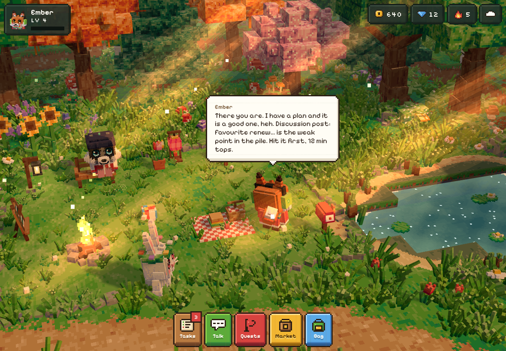
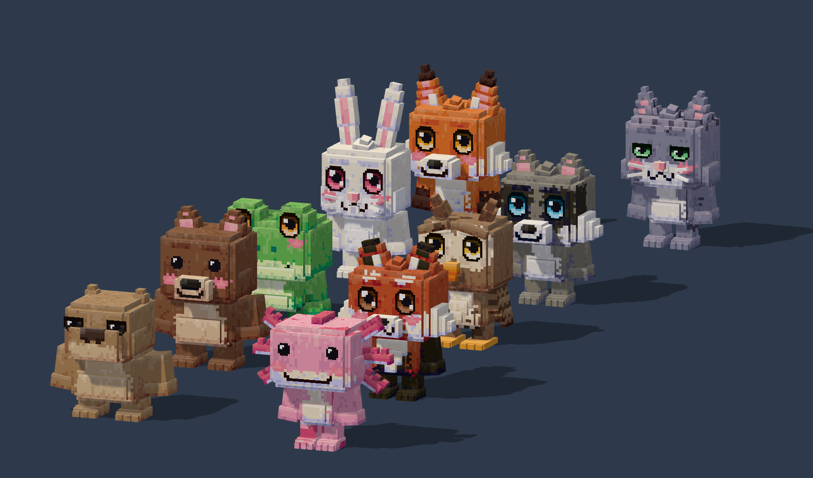
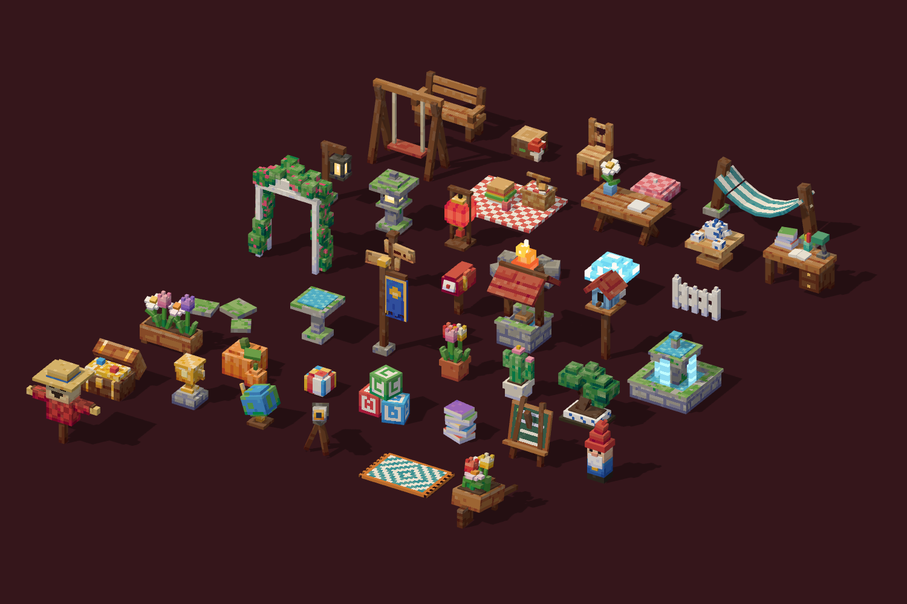
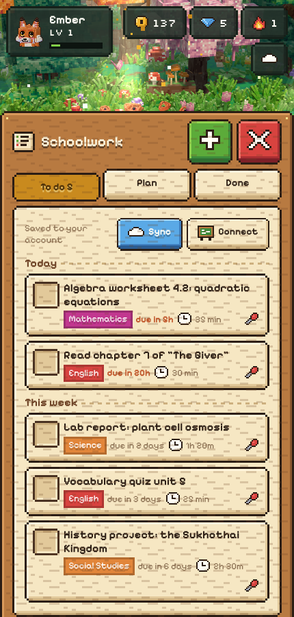

# Sidekick

An animal friend who lives in a blocky forest on your phone or tablet, keeps your schoolwork in order,
tells you the fastest way through it, and hops onto your desktop when you sit down to study.



- **Forest**: a hand-built diorama in a Minecraft-Dungeons-like style. Every plant is real 3D geometry
  with painted pixel textures: grass clumps, seven kinds of flowers, mushrooms, voxel-sculpted trees,
  a pond with lily pads and koi, wind, falling leaves, sun shafts, fireflies, a day/night cycle.
- **Animals**: ten species on one rig (fox, cat and bunny to start; raccoon, frog, owl, bear, red panda,
  capybara and axolotl to unlock), each with its own personality and voice, customisable fur, markings,
  eyes, ears, tail and build, and about fifty outfit pieces. They wander, sit on furniture, eat, nap,
  dance, sniff flowers, chase butterflies and react to what you do.
- **Schoolwork**: assignments from Google Classroom, Microsoft Teams (Education) and any iCal feed
  (Canvas, Moodle, Schoology), plus your own. Ranked plan, quickest route through each task, ready-made
  tutor prompts, reminders, focus timer.
- **Game**: coins, XP, levels, streaks, daily and weekly quests, snacks, a garden plot where furniture can
  be placed freely, a market, optional Plus subscription and an optional rewarded-ad slot.
- **Desktop**: an Electron overlay where the same animal walks along the bottom of your screen and nudges
  you. It leaves the forest in a swirl of pixels and re-forms on the desktop, and back again.

## Run it

Needs Node 22.13 or newer.

```bash
npm install
```

```bash
npm run dev
```

Open http://localhost:5173. The server listens on 8787 and the web dev server proxies to it.
Everything works without any keys: the app saves locally, syncs through the server, and the sidekick
uses its built-in planner and lines.

For a single-process deployment, build the web app and let the server serve it:

```bash
npm run build
```

```bash
npm start
```

Desktop companion (with the server running):

```bash
npm run desktop
```

Set `SIDEKICK_URL` if the server is not on `http://localhost:8787`. On first launch it asks for a link
code: in the app open Bag, Settings, Devices, "Link another device".

### Turning on the optional parts

Copy `.env.example` to `.env` and fill in what you want. `docs/SERVER.md` has click-by-click setup.

| Feature | Needs |
|---|---|
| Real AI conversation and AI planning | `ANTHROPIC_API_KEY` (model defaults to `claude-opus-5-5`, change with `SIDEKICK_MODEL`) |
| Google Classroom | a Google Cloud OAuth client: `GOOGLE_CLIENT_ID`, `GOOGLE_CLIENT_SECRET`, `PUBLIC_URL` |
| Microsoft Teams assignments | a Microsoft Entra app registration: `MS_CLIENT_ID`, `MS_CLIENT_SECRET`; school tenants usually need admin consent |
| iCal feeds | nothing: paste the feed link in Settings |
| Push notifications | nothing (keys are generated); on iPhone and iPad the app must be added to the Home Screen first |
| Plus subscription | Stripe keys: `STRIPE_SECRET_KEY`, `STRIPE_PRICE_ID`, `STRIPE_WEBHOOK_SECRET` |

## What has been verified, and what has not

Verified in this repository:

- `npm test`: 271 server and shared-logic tests (sync merge, presence and device hops, ICS parsing,
  Classroom and Graph mappers, import rules, chat tool loop, scheduler, billing signature, SSRF guard).
- `node scripts/e2e.mjs` against the real server and web app in a headless browser: device registration,
  save sync, chat fallback, task completion and rewards, pairing a second device, the hop to the desktop
  overlay and the call back.
- Every screen rendered and checked by screenshot at phone size; furniture placement in the garden.
- The Electron shell starts and loads the overlay under a virtual display.
- `npm run typecheck` and `npm run build`.

Not verified, so treat as untested until you try it:

- **AI against the live API.** No API key was available. Requests are built with the official SDK and
  exercised against a scripted transport only. With no key the sidekick says it is in offline mode.
- **Google Classroom and Microsoft Teams against real accounts.** Implemented from the public API
  documentation and tested against hand-written fixtures. `docs/SERVER.md` lists the assumptions.
- **Stripe checkout and webhooks** against Stripe itself.
- **Real phones, tablets and GPUs.** All rendering checks ran in a software renderer. There is a low and a
  high detail tier; performance on real devices is unmeasured.
- **Desktop transparency and click-through** on Windows, macOS or a Linux compositor.
- **How the sounds sound.** Every file has a verified licence, but none was auditioned by ear.

Deliberately not built:

- **Native home-screen widgets.** A web app cannot provide iOS or Android widgets; that needs a native
  wrapper. The desktop overlay and push notifications cover the same job for now.
- **A real ad network.** The rewarded-ad slot is a labelled placeholder that still pays the coins.
- **Spoken voices.** Each species talks in pitched babble made from a real recorded sample.

## About the look

The art direction is blocky, cuboid-built models with pixel textures in the manner of the reference
sheets: hue-shifted palettes, lit top faces, rim highlights, offset shadows. Models are authored as boxes
measured in pixels (16 px to a block) and their textures are painted procedurally per texel, so there are
no image files for the art. Animals use twice the world's texel density for finer fur and faces.

It is in the same family as the references, not a pixel-for-pixel match. The textures are generated by
painters written for each material rather than drawn one pixel at a time by an artist, and the scene has
no post-processing (bloom, ambient occlusion, depth of field) of the kind Minecraft Dungeons uses.
`node scripts/shots.mjs sheet:animals sheet:furniture sheet:plants sheet:trees` renders contact sheets
laid out like the references for side-by-side comparison.

| | | |
|---|---|---|
|  |  |  |

## Layout

```
shared/    data model, sync merge, personas, offline planner, API contract
web/       the app: gfx (model + texture builder), assets, world, core (state, sound, net), ui, pet
server/    sync, presence, integrations, AI, push, billing, tests
desktop/   Electron shell for the overlay
scripts/   dev runner, screenshot harness, end-to-end smoke test
docs/      SERVER.md (setup), AUDIO-CREDITS.md (every sound, author, source, licence)
```

## Credits

Sound effects are CC0 recordings from OpenGameArt contributors and public-domain recordings from the
U.S. National Park Service; see `docs/AUDIO-CREDITS.md`. Fonts are Pixelify Sans and Silkscreen (SIL Open
Font License). Built with three.js and Preact.
